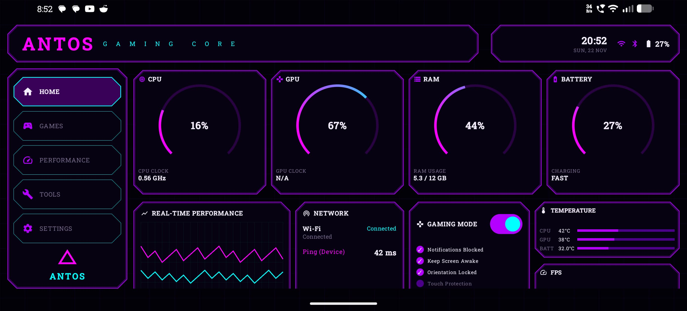
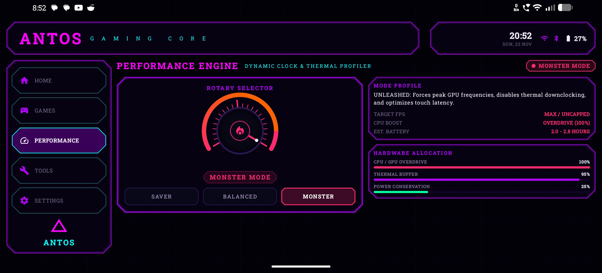
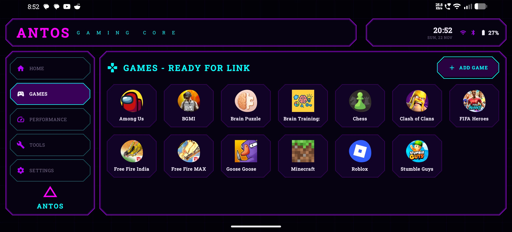
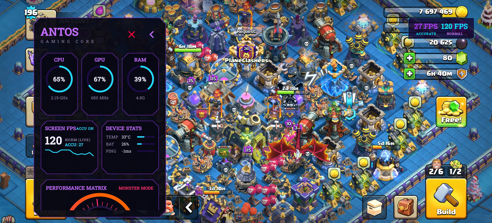
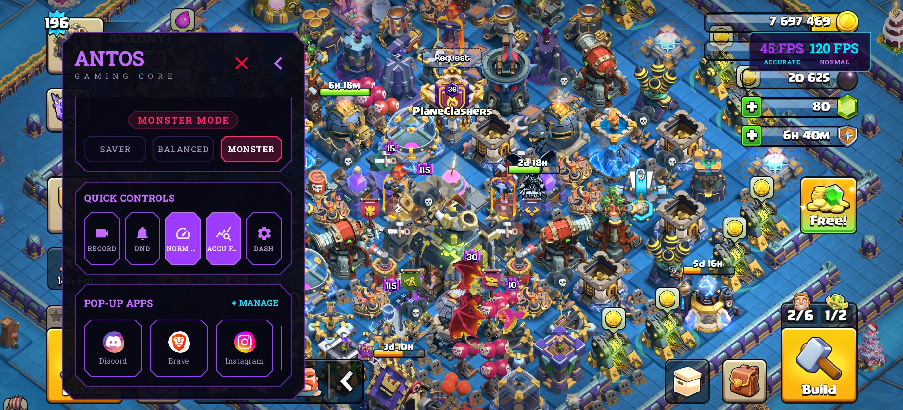
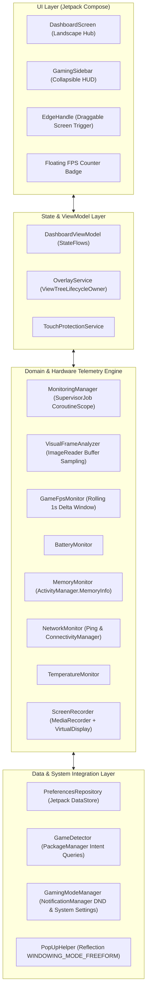

# GAME-CORE-ANTOS 🎮⚡

[-3DDC84?style=for-the-badge&logo=android&logoColor=white)](https://developer.android.com)
[-00E676?style=for-the-badge&logo=android&logoColor=black)](https://github.com/t2toni/GAME-CORE-ANTOS/releases/download/v1.0.0/AntosGaming.apk)
[](https://github.com/t2toni/GAME-CORE-ANTOS/releases/latest)
[](https://kotlinlang.org)
[](https://developer.android.com/jetpack/compose)
[](https://developer.android.com/topic/architecture)
[](https://github.com/Kotlin/kotlinx.coroutines)
[](https://robolectric.org/)
[](LICENSE)

> **ANTOS Gaming Core** is an open-source, cyberpunk-themed Android gaming companion and in-game telemetry HUD. Built with modern **Kotlin** and **Jetpack Compose**, ANTOS delivers non-intrusive in-game telemetry, non-root visual frame-rate analysis, freeform floating app shortcuts, hardware-accelerated screen recording, distraction blocking, and accidental touch shielding.

<p align="center">
  <a href="https://github.com/t2toni/GAME-CORE-ANTOS/releases/download/v1.0.0/AntosGaming.apk">
    
  </a>
  &nbsp;&nbsp;
  <a href="https://github.com/t2toni/GAME-CORE-ANTOS/releases/latest">
    
  </a>
</p>

---

## 📸 App Preview & Screenshots

<div align="center">
  <table>
    <tr>
      <td align="center"><b>🎮 Cyberpunk Dashboard</b></td>
      <td align="center"><b>📊 Real-Time Hardware Telemetry</b></td>
    </tr>
    <tr>
      <td></td>
      <td></td>
    </tr>
    <tr>
      <td align="center"><b>🕹️ Game Library Hub</b></td>
      <td align="center"><b>⚡ In-Game Floating HUD (Overlay)</b></td>
    </tr>
    <tr>
      <td></td>
      <td></td>
    </tr>
    <tr>
      <td colspan="2" align="center"><b>🚀 In-Game Quick Tools & Pop-Up Shortcuts</b></td>
    </tr>
    <tr>
      <td colspan="2" align="center"></td>
    </tr>
  </table>
</div>

---

## 📑 Table of Contents
- [Architecture & Design Principles](#-architecture--design-principles)
- [Comprehensive Feature Catalog](#-comprehensive-feature-catalog)
- [Deep-Dive Engineering Highlights](#-deep-dive-engineering-highlights)
- [Platform Support & The iOS Question](#-platform-support--the-ios-question)
- [Technology Stack Matrix](#-technology-stack-matrix)
- [Project Directory Structure](#-project-directory-structure)
- [Getting Started & Build Instructions](#-getting-started--build-instructions)
- [Testing & Quality Assurance](#-testing--quality-assurance)
- [License & Author](#-license--author)

---

## 🏛 Architecture & Design Principles

ANTOS Gaming Core follows **Clean Architecture**, **MVVM (Model-View-ViewModel)**, and **Unidirectional Data Flow (UDF)** to ensure high testability, modularity, and strict separation of concerns.



---

## ⚡ Comprehensive Feature Catalog

### 1. In-Game Floating HUD & Collapsible Sidebar
- **Docked Draggable Edge Handle (`EdgeHandle.kt`)**: A low-profile, touch-responsive handle anchored to the device border. A gentle swipe inward or tap deploys the in-game HUD overlay without interrupting gameplay.
- **Compose Inside WindowManager (`OverlayService.kt`)**: Renders reactive Jetpack Compose layouts directly inside Android's `WindowManager` using `TYPE_APPLICATION_OVERLAY`. By binding custom `ViewTreeLifecycleOwner`, `ViewTreeViewModelStoreOwner`, and `ViewTreeSavedStateRegistryOwner`, the overlay hosts full Compose lifecycles and animations without requiring an underlying `Activity`.
- **Dedicated Draggable FPS Badge**: A minimalist floating badge displaying real-time FPS that can be freely dragged anywhere on the screen during gameplay.
- **Cyberpunk Sci-Fi Design System**: Custom neon color palettes (Cyan `#00FFFF`, Magenta `#FF00FF`, Neon Purple `#B300FF`), angular cut-corner HUD containers (`cutCornerShape`), pulsing animated glow borders (`sciFiBorder`), and canvas-rendered cybernetic background grids.

### 2. Dual Real-Time FPS Telemetry Engine
ANTOS provides two distinct FPS measurement methodologies to adapt to any runtime scenario:
- **Non-Root Visual Game FPS (`VisualFrameAnalyzer.kt` & `GameFpsMonitor.kt`)**:
  - Android strictly isolates Vulkan and OpenGL render surfaces between apps; standard applications cannot query another game's internal frame swaps without root or ADB access.
  - ANTOS solves this using non-intrusive visual frame diffing via `MediaProjection` and `ImageReader` in `PixelFormat.RGBA_8888`.
  - Samples a spatial 9-point coordinate matrix `(0.2, 0.5, 0.8)` across framebuffer planes.
  - Direct byte-buffer position seeking avoids full-resolution hashing, achieving zero garbage collection churn and negligible CPU overhead.
  - Dispatches frame events to `GameFpsMonitor`, which calculates instantaneous FPS, rolling 1-second average FPS, minimum FPS, maximum FPS, and maintains a rolling 20-sample sparkline history.
- **UI Frame Pacing Monitor (`FpsMonitor.kt`)**:
  - Utilizes Android's `Choreographer.FrameCallback` to measure UI thread frame presentation intervals and dropped VSYNC cycles.

### 3. Hardware & Telemetry Suite (`MonitoringManager.kt`)
Aggregated into reactive `StateFlow` streams through a unified singleton manager backed by a `SupervisorJob` CoroutineScope:
- **Memory Consumption (`MemoryMonitor.kt`)**: Real-time available RAM and total system capacity via `ActivityManager.MemoryInfo`.
- **Battery & Power Profiling (`BatteryMonitor.kt`)**: Live battery percentage, charging states, and discharge rates via sticky system broadcasts.
- **Thermal Gauges (`TemperatureMonitor.kt`)**: Continuously reads hardware thermal sensors to alert gamers against thermal throttling.
- **Network Latency & Connection Profiling (`NetworkMonitor.kt`)**: Detects active network transports (Wi-Fi, 5G/4G Cellular, Ethernet) and issues periodic asynchronous gateway pings to display live ping round-trip times (ms).

### 4. Hardware-Accelerated Screen Recording (`ScreenRecorder.kt`)
- **High-Definition Capture**: Records gameplay at 1080p, 60 FPS, with an 8 Mbps encoding bitrate using `MediaProjection`, `VirtualDisplay`, and hardware-accelerated `MediaRecorder` (H.264 / MP4).
- **Automated Directory Organization**: Automatically manages video storage paths, saving clips to `Movies/ANTOS/ANTOS_<timestamp>.mp4`.
- **One-Tap Quick Actions**: Trigger, pause, and stop recording sessions directly from the in-game HUD or the main dashboard.

### 5. Freeform Floating Pop-Up Apps (`PopUpHelper.kt`)
- Launch external apps (e.g., Discord, Brave Browser, Instagram, WhatsApp) directly inside resizable floating pop-up windows over active gameplay.
- Leverages reflection-based windowing flags (`WINDOWING_MODE_FREEFORM = 5`) combined with `Intent.FLAG_ACTIVITY_NEW_TASK`, `Intent.FLAG_ACTIVITY_MULTIPLE_TASK`, and `Intent.FLAG_ACTIVITY_NEW_DOCUMENT`.
- Dynamically computes display metrics bounds (`launchBounds = Rect(...)`) centered on screen (75% width, 65% height), with automatic fallback to standard intent launching on unsupported OEM skins.

### 6. Gaming Mode & Distraction Blocker (`GamingModeManager.kt`)
- **Do Not Disturb (DND) Automation**: Programmatically toggles Android notification policy filters (`NotificationManager.INTERRUPTION_FILTER_NONE`) to eliminate notification popups during matches.
- **Display Optimization**: One-tap toggles to enforce orientation locks and override brightness to maximum presets (`Settings.System.SCREEN_BRIGHTNESS = 255`) for superior visibility in dark gaming environments.

### 7. Accidental Touch Protection Shield (`TouchProtectionService.kt`)
- Deploys a full-screen transparent interceptor layer over active games using `WindowManager.LayoutParams.TYPE_APPLICATION_OVERLAY`.
- Guards against palm presses, edge touches, and accidental gestures during high-APM gaming sessions or AFK grinding.
- Dismissed instantly via an intuitive double-tap gesture.

### 8. Game Library & Per-Game Profiles (`PreferencesRepository.kt`)
- **Automated Game Discovery (`GameDetector.kt`)**: Queries Android's `PackageManager` for installed packages flagged with `ApplicationInfo.CATEGORY_GAME` or `ApplicationInfo.FLAG_IS_GAME`.
- **Manual Game Picker (`AppPickerScreen.kt`)**: Allows users to add any installed app or emulator into the gaming suite.
- **Per-Game Tailored Profiles (`GameProfile.kt`)**: Persists custom configurations per game using **Jetpack Preferences DataStore** (Performance Mode, Custom Brightness, Orientation Lock, DND suppression, FPS counter, Touch Protection).

### 9. Permission Center & Boot Integration (`PermissionManager.kt` & `BootReceiver.kt`)
- **Centralized Permission Hub**: Inspects and directs users to dedicated system settings pages for critical permissions: `SYSTEM_ALERT_WINDOW`, `WRITE_SETTINGS`, `PACKAGE_USAGE_STATS`, DND Access, and `MediaProjection`.
- **Boot Startup (`BootReceiver.kt`)**: Optionally initializes the overlay service automatically upon device boot (`RECEIVE_BOOT_COMPLETED`).

---

## 🔬 Deep-Dive Engineering Highlights

### 1. Rendering Jetpack Compose in a WindowManager Service
Jetpack Compose normally relies on an `androidx.activity.ComponentActivity` to supply `LifecycleOwner`, `ViewModelStoreOwner`, and `SavedStateRegistryOwner`. Because `OverlayService` is a background `Service`, directly attaching a `ComposeView` causes runtime crashes.

ANTOS solves this by implementing these interfaces directly in `OverlayService`:
```kotlin
class OverlayService : Service(), LifecycleOwner, ViewModelStoreOwner, SavedStateRegistryOwner {
    private val lifecycleRegistry = LifecycleRegistry(this)
    private val store = ViewModelStore()
    private val savedStateRegistryController = SavedStateRegistryController.create(this)

    private fun showOverlay() {
        composeView = ComposeView(this).apply {
            setViewTreeLifecycleOwner(this@OverlayService)
            setViewTreeViewModelStoreOwner(this@OverlayService)
            setViewTreeSavedStateRegistryOwner(this@OverlayService)
            setContent {
                AntosTheme {
                    OverlayComposeView(...)
                }
            }
        }
        windowManager.addView(composeView, layoutParams)
    }
}
```

### 2. Zero-Copy Non-Root Game FPS Measurement
Hashing an entire 1080p/1440p RGBA buffer 60–120 times per second causes massive memory bandwidth consumption and GC pauses. ANTOS implements a sparse 9-point spatial sampling algorithm:
```kotlin
// VisualFrameAnalyzer.kt
val points = arrayOf(
    0.20f to 0.20f, 0.50f to 0.20f, 0.80f to 0.20f,
    0.20f to 0.50f, 0.50f to 0.50f, 0.80f to 0.50f,
    0.20f to 0.80f, 0.50f to 0.80f, 0.80f to 0.80f
)
// Direct ByteBuffer position offset calculation based on rowStride & pixelStride
val position = y * rowStride + x * pixelStride
buffer.position(position)
// Sample minimal bytes without allocating new byte arrays
```

---

## 📱 Platform Support & The iOS Question

### Why Native Android?
A common question from recruiters and hiring managers is: **"Can this run on both iOS and Android?"**

The core features that make ANTOS Gaming Core a powerhouse rely fundamentally on **low-level Android OS architectures**:
1. **System Alert Window (`SYSTEM_ALERT_WINDOW`)**: Android permits authorized background services to render interactive overlays (`TYPE_APPLICATION_OVERLAY`) over other third-party apps. Apple's iOS sandbox strictly prohibits any app from rendering overlays or floating windows over another application.
2. **Background Screen Analysis (`MediaProjection`)**: Android allows user-authorized background virtual displays to capture screen buffer pixels. iOS ReplayKit is limited to in-app recording or broadcast extensions with severe memory constraints (50 MB cap) and cannot inspect external game rendering.
3. **Freeform Windowing (`WINDOWING_MODE_FREEFORM`)**: Android OS supports multi-window and freeform floating window modes. iOS does not support floating multi-window pop-ups on iPhones.
4. **Kernel Telemetry**: Android provides Linux sysfs access (`/sys/devices/system/cpu`) and battery sticky broadcasts. iOS sandboxes prevent access to CPU clock frequencies, thermal zones, and battery discharge rates.

> **Engineering Takeaway:** ANTOS Gaming Core serves as an elite showcase of **deep Android Systems Engineering**, demonstrating mastery of Android IPC, WindowManager, MediaProjection, Foreground Services, Coroutines, and Jetpack Compose internals.

### Cross-Platform Roadmap (Kotlin Multiplatform)
For teams seeking multiplatform expansion, the recommended architectural path is:
- **Shared Domain & Data (KMP)**: Port data models, Game Profiles, preferences serialization, and network telemetry to Kotlin Multiplatform (`commonMain`).
- **iOS Companion App**: Deliver an iOS companion dashboard using **Compose Multiplatform** for game catalog tracking, gaming community wikis, and cloud telemetry sync, while retaining the deep overlay engine natively on Android.

---

## 🛠 Technology Stack Matrix

| Component | Library / API | Version | Architectural Role |
|---|---|---|---|
| **Language** | Kotlin | `1.9.0` | Modern, null-safe asynchronous programming |
| **UI Framework** | Jetpack Compose | BOM `2024.06.00` | Declarative, reactive UI rendering |
| **Design System** | Material 3 & Custom Canvas | `1.2.1` | Cyberpunk-themed custom HUD and drawing scopes |
| **Concurrency** | Kotlin Coroutines & Flow | `1.8.1` | Reactive streams (`StateFlow`), background telemetry |
| **Data Persistence** | AndroidX Preferences DataStore | `1.1.1` | Asynchronous, type-safe settings storage |
| **Window Management** | Android WindowManager | System API | `TYPE_APPLICATION_OVERLAY` for in-game floating HUD |
| **Screen Capture** | MediaProjection & ImageReader | System API | Non-root frame signature diffing & frame pacing |
| **Video Encoding** | MediaRecorder & VirtualDisplay | System API | Hardware-accelerated 1080p 60fps H.264 screen capture |
| **Unit Testing** | JUnit 4, Robolectric, Mockito | `4.11.1` / `5.7.0` | High-fidelity JVM unit testing without emulators |
| **Instrumentation** | Compose UI Test & Espresso | `2024.06.00` | Automated UI component testing |

---

## 📂 Project Directory Structure

```
AntosGaming/
├── app/
│   ├── src/
│   │   ├── main/
│   │   │   ├── AndroidManifest.xml          # Permissions, services, activities declarations
│   │   │   ├── java/com/antos/gaming/
│   │   │   │   ├── MainActivity.kt          # Landscape-locked Compose entry point
│   │   │   │   ├── FloatingAppLauncher.kt   # Freeform popup intent builder
│   │   │   │   ├── data/                    # PreferencesRepository, GameProfile
│   │   │   │   ├── games/                   # GameDetector, GameApp package scanner
│   │   │   │   ├── monitoring/              # VisualFrameAnalyzer, GameFpsMonitor, FpsMonitor,
│   │   │   │   │                            # Battery, Memory, Network, Temp monitors
│   │   │   │   ├── permissions/             # PermissionManager (Intent helpers & checks)
│   │   │   │   ├── recording/               # ScreenRecorder, MediaRequestActivity
│   │   │   │   ├── service/                 # OverlayService, GamingModeManager, TouchProtectionService
│   │   │   │   ├── settings/                # SettingsManager (DataStore flows)
│   │   │   │   └── ui/
│   │   │   │       ├── components/          # RotarySlider, custom widgets
│   │   │   │       ├── dashboard/           # DashboardScreen, DashboardViewModel, AppPickerScreen
│   │   │   │       ├── settings/            # SettingsScreen, PermissionCenterScreen
│   │   │   │       ├── sidebar/             # GamingSidebar, OverlayComposeView, HudComponents, PopUpHelper
│   │   │   │       └── theme/               # Cyberpunk Color, Theme, Type tokens
│   │   │   └── res/                         # Vector drawables, themes, strings
│   │   ├── test/                            # Unit tests (Robolectric, Mockito, Coroutines Test)
│   │   └── androidTest/                     # Compose UI instrumentation tests
│   └── build.gradle.kts                     # App-level dependencies & build config
├── gradle/wrapper/                          # Gradle 8.5 distribution wrapper
├── build.gradle.kts                         # Root-level build configuration
├── settings.gradle.kts                      # Repository definitions & project inclusion
├── .gitignore                               # Clean Android git hygiene
└── README.md                                # Project documentation
```

---

## 🚀 Getting Started & Build Instructions

### Prerequisites
- **JDK**: Version 17 (configured in your `JAVA_HOME`)
- **Android Studio**: Jellyfish, Koala, Ladybug or newer
- **Android SDK**: `compileSdk = 35`, `minSdk = 26` (Android 8.0 Oreo or higher)

### Build via Command Line (Gradle Wrapper)
```bash
# Clone the repository
git clone https://github.com/t2toni/GAME-CORE-ANTOS.git
cd GAME-CORE-ANTOS

# Build debug APK
./gradlew assembleDebug

# Run all unit tests
./gradlew testDebugUnitTest

# Install debug APK to connected device/emulator
./gradlew installDebug
```

Compiled APK output path:
```
app/build/outputs/apk/debug/app-debug.apk
```

### Initial Device Setup
1. Launch **ANTOS Gaming** on your device.
2. Navigate to **Settings -> Permissions** (or click the Permission Shield on the Dashboard).
3. Grant the required system permissions:
   - **Display over other apps** (`SYSTEM_ALERT_WINDOW`)
   - **Modify system settings** (`WRITE_SETTINGS`)
   - **Do Not Disturb access** (Notification policy access)
   - **Screen Recording** (Authorized on-demand during capture sessions)

---

## 🧪 Testing & Quality Assurance

ANTOS includes automated test suites covering unit logic and UI interactions:

```bash
# Execute unit tests with Robolectric
./gradlew testDebugUnitTest
```

- **`GameDetectorTest`**: Verifies package filtering, launcher category queries, and self-package exclusion.
- **`PreferencesRepositoryTest`**: Asserts DataStore serialization, profile updates, and game preference persistence.
- **`MemoryMonitorTest`**: Verifies RAM parsing and calculations against `ActivityManager.MemoryInfo`.
- **`PermissionManagerTest`**: Asserts generation of system permission intent URIs.
- **`DashboardScreenTest` & `OverlayComposeViewTest`**: Compose UI automated tests verifying view states and interaction flows.

---

## 📄 License & Author

Distributed under the **Apache License 2.0**. See `LICENSE` for more information.

Developed with 💜 by **Tony**  
- **GitHub**: [@t2toni](https://github.com/t2toni)  
- **Repository**: [https://github.com/t2toni/GAME-CORE-ANTOS](https://github.com/t2toni/GAME-CORE-ANTOS)
